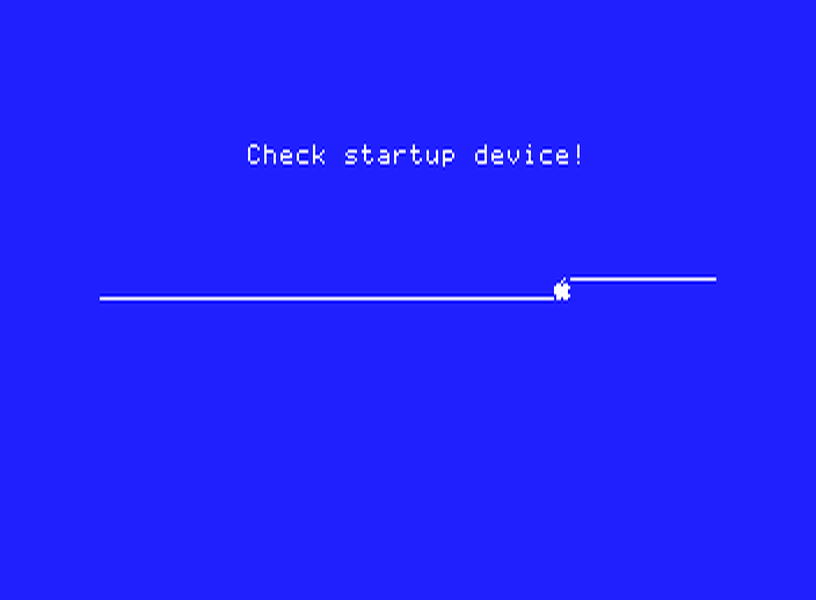
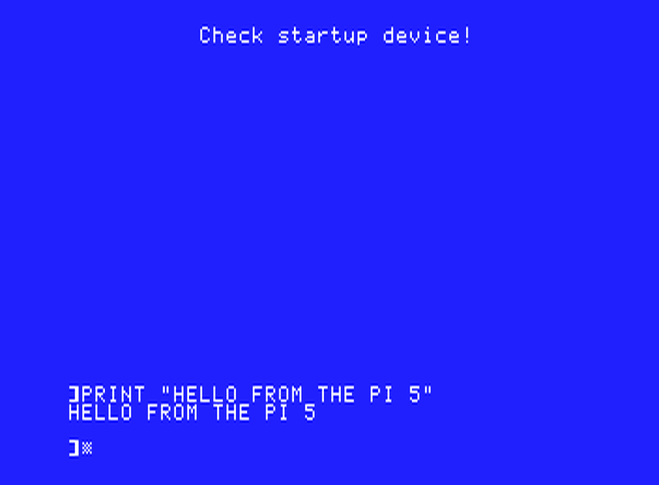
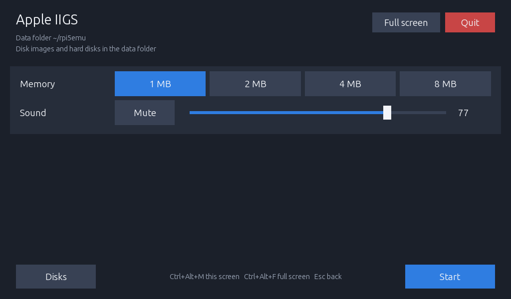
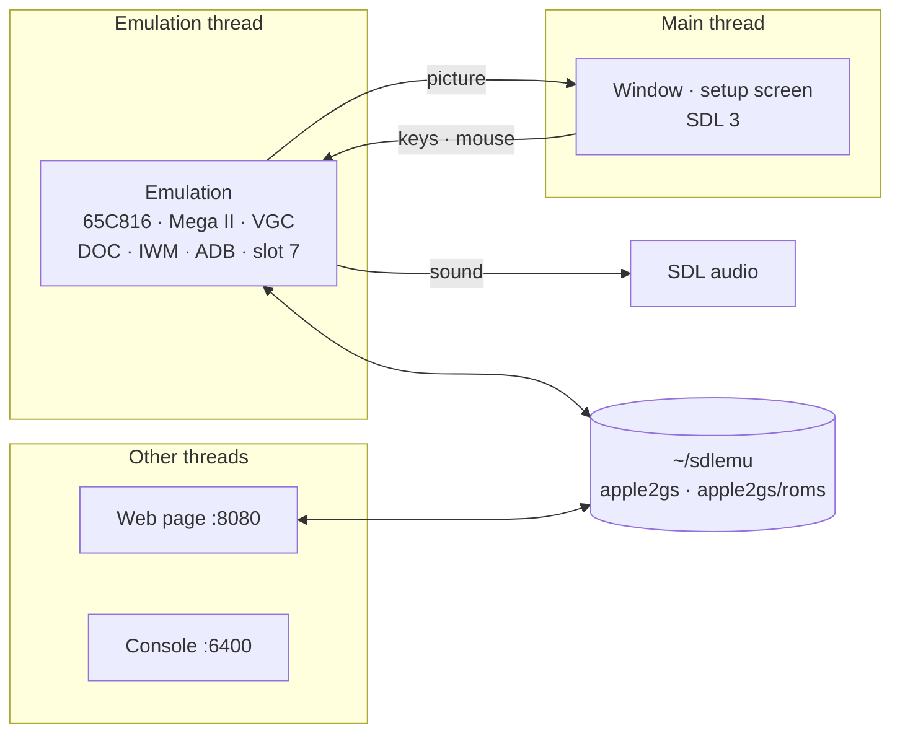

<h1 align="center">sdlgs</h1>

<p align="center">
  <b>An Apple IIGS in an SDL 3 window on Linux or macOS.</b><br>
  ROM 3, GS/OS 6 from floppies or hard disks, Super Hi-Res and all the Apple II modes, Ensoniq sound.
</p>

<p align="center">
  
  
  
  
  
  
</p>

<p align="center">
  <b>Work in progress:</b> not everything has been tested, and games and demos may or may not
  work satisfactorily.
</p>

<p align="center">
  
  
  <br>
  <sub>The IIGS's ROM 3 looking for a startup disk, and Applesoft after Control-Reset, on the Pi.</sub>
</p>

sdlgs runs [esp32gs](https://github.com/rlucencic/esp32gs)'s IIGS on 64-bit Linux (arm64 and amd64) and Apple Silicon macOS. SDL 3 provides the window, sound and input. The machine is the
same code as on the ESP32 boards: esp32gs's platform-independent core and
[esp32emu](https://github.com/rlucencic/esp32emu)'s CPU core, on
[sdlemu](https://github.com/rlucencic/sdlemu), the family's desktop runtime: a setup
screen in the window, sound, the host's keyboard and mouse, a web page on your network and a
console.

It belongs to the SDL desktop family of the ESP32 emulators:
[sdlzx](https://github.com/rlucencic/sdlzx) (ZX Spectrum),
[sdlcpc](https://github.com/rlucencic/sdlcpc) (Amstrad CPC),
[sdlcbm](https://github.com/rlucencic/sdlcbm) (Commodore 64 and 128),
[sdlcoco](https://github.com/rlucencic/sdlcoco) (Tandy Color Computer 2 and 3),
[sdlmsx](https://github.com/rlucencic/sdlmsx) (MSX1 and MSX2),
[sdlxl](https://github.com/rlucencic/sdlxl) (Atari 800XL and 130XE),
[sdlste](https://github.com/rlucencic/sdlste) (Atari STE),
[sdlpc](https://github.com/rlucencic/sdlpc) (IBM PC/XT and PC/AT),
[sdlmac](https://github.com/rlucencic/sdlmac) (Macintosh Plus, SE, Classic),
[sdlmac2](https://github.com/rlucencic/sdlmac2) (Macintosh LC and II),
[sdlmac3](https://github.com/rlucencic/sdlmac3) (Macintosh LC II and LC III),
[sdlarc](https://github.com/rlucencic/sdlarc) (Acorn Archimedes),
[sdlami](https://github.com/rlucencic/sdlami) (Amiga 500, 2000, 600, 1200).

## Features

**The machine**
- **Apple IIGS, ROM 3**: 1, 2, 4 or 8 MB, chosen on the
  setup screen
- **65C816** at 2.8 or 1 MHz as the IIGS switches, emulation and native
  mode; checked against the 5 million SingleStepTests
- **Video**: Super Hi-Res 320 and 640 with a palette per line and fill
  mode, text in 40 and 80 columns with MouseText, lores, double lores, hires
  and double hires, mixed modes, the border colour
- **Sound**: the Ensoniq DOC's 32 oscillators and the Apple II speaker
- **ADB keyboard and mouse**, the clock and battery RAM (the control panel's
  settings are kept)

**Drives**
- **3.5"** (slot 5): 800 KB and 400 KB disks, `.po`, `.2mg`, `.woz`
- **5.25"** (slot 6): 140 KB disks, `.dsk`/`.do` (DOS order), `.po`, `.woz`
- **Two hard disks** (a card in slot 7): ProDOS block images of any size up
  to 32 MB, `.po`, `.hdv`, `.2mg`, read and written in place
- Writes go back into the image files (floppies a second after the drive's
  motor stops); `.woz` is read-only
- **New blank disks**: 800 KB, 140 KB, 16 or 32 MB, ready for GS/OS to
  initialise

**Around it**
- **A window** of its own on the Pi's desktop (X11 or Wayland), resizable, full screen
  with Ctrl+Alt+F; the picture in the machine's shape, smoothly scaled
- **Setup screen** in the window, first thing at start and any time with Ctrl+Alt+M:
  memory, the sound's volume, the drives and their images (insert, eject, new
  blank ones), Start / Back / Restart, Reset
- **The Pi's keyboard and mouse**: keys by position, as the boards' Bluetooth keyboards;
  a click in the window gives the mouse to the machine, Ctrl+Alt+G takes it back
- **Web page** at `http://<the Pi>:8080/`: drop images (or ZIP files) onto it, insert
  them, make blank ones, and watch the machine and its drives live
- **Sound** through SDL (PipeWire, PulseAudio or ALSA), the machine paced by the clock
- **Console** on the terminal and on `127.0.0.1:6400`: keys, typing, drives, screenshots

<p align="center">
  
  <br><sub>The setup screen in the window, before the IIGS starts</sub>
</p>

## Getting started

### 1. What you need

- 64-bit Linux (including Raspberry Pi 5) or Apple Silicon macOS with SDL 3.2 or newer. See [desktop build dependencies](https://github.com/rlucencic/sdlemu#building).
- [esp32emu](https://github.com/rlucencic/esp32emu), [sdlemu](https://github.com/rlucencic/sdlemu)
  and [esp32gs](https://github.com/rlucencic/esp32gs), cloned next to this project
- The ROMs (below)

### 2. Build

```sh
git clone https://github.com/rlucencic/esp32emu.git
git clone https://github.com/rlucencic/sdlemu.git
git clone https://github.com/rlucencic/esp32gs.git
git clone https://github.com/rlucencic/sdlgs.git && cd sdlgs
cmake -S . -B build -G Ninja && cmake --build build
```

### 3. ROMs

In the data folder's `apple2gs/roms/` (`~/sdlemu/apple2gs/roms`), named as
esp32gs's: `gs_rom3.rom` (256 KB) and `chargen.rom` (4 KB). Not part of this
repository.

### 4. First start

1. `build/sdlgs`: the setup screen opens in a window.
2. Choose the memory and click **Start**.
3. Put images into `~/sdlemu/apple2gs/`, drop them on the window or the web page, and
   insert them on the setup screen's **Disks** page.

## Using it

| To | Do |
|---|---|
| Get back to the setup screen | Ctrl+Alt+M (the machine waits meanwhile) |
| Full screen | Ctrl+Alt+F |
| Give the mouse to the machine, take it back | A click in the window; Ctrl+Alt+G |
| Run as fast as it goes (warp) | Ctrl+Alt+W, again for real speed |
| Take a screenshot | Ctrl+Alt+S (into `~/sdlemu/screenshots`), or the console's `s` |
| Insert an image | The setup screen's **Disks** page, drop it on the window or the web page, or name it on the command line: `build/sdlgs System.Disk.po` |
| Start straight into the machine | `build/sdlgs -S`, with the setup screen's rows as `--choice`: `build/sdlgs -S --choice "Memory=4 MB"` |
| Show the window on another computer | Log in with `ssh -C -Y <the Pi>` and start it there: fine for still pictures; games want the Pi's own monitor |
| Use a 3.5" disk under GS/OS | Insert it while GS/OS runs: its icon appears on the desktop. **Eject** in the Finder takes it out of the drive |
| Get to Applesoft BASIC | Control-Reset (Control-F12) while the IIGS looks for a disk |

Images live in `~/sdlemu/apple2gs/`, settings in `~/.config/sdlemu/settings.ini`; the
inserted images are remembered across starts. `build/sdlgs --help` lists the options.

**Keyboard**: by position, as on Apple's keyboard (US). Return, Esc, Tab,
Delete (Backspace), Caps Lock, the cursor keys and the keypad as themselves;
Ctrl is Control, Alt is Option, the Windows or Command key is the open apple
(Command); F12 or Pause is Reset (Control-F12: Control-Reset;
Control-Command-F12 restarts).

## How it works



- **[esp32gs](https://github.com/rlucencic/esp32gs)'s `components/apple2gs`**: the IIGS,
  platform independent: the same code runs on the ESP32 boards.
- **`src/`**: the glue, esp32gs's `main/main.c` ported: memory, ROMs, settings, keyboard map,
  drives and status.
- **[sdlemu](https://github.com/rlucencic/sdlemu)**: the window, the setup screen, sound,
  input, the web page, the console, the data folder and the settings.
- **[esp32emu](https://github.com/rlucencic/esp32emu)**: the CPU core (65C816).

## Development

```sh
../sdlemu/tools/pi.sh sdlgs build        # from another computer: sync to the Pi, build there
../sdlemu/tools/pi.sh sdlgs run          # its window on this computer (ssh -C -Y)
../sdlemu/tools/pi.sh sdlgs headless     # no window: drive it through the console
../sdlemu/tools/console.sh i 's /tmp/shot.png'
```

`CLAUDE.md` has the details: the layout, how it was ported, the checks; esp32gs's own
`CLAUDE.md` has the machine's.

## Limitations

- Checked on the Pi through its console and screenshots: ROM 3 at full speed to its startup screen; Control-Reset to Applesoft and typing. Not yet by hand
  in the window, with the sound heard, or with much software.
- Over X forwarding (`ssh -Y`) every changed picture crosses the network: 8 to 15 a second.
- Tried so far: ROM 3's startup and Applesoft, GS/OS 6.0.1 and 6.0.4 from
  floppies and hard disks, the Finder (windows, menus, About), a floppy
  inserted while GS/OS runs, DOS 3.3 (CATALOG, SAVE, RUN), the Tour of the
  Apple IIGS. **Games and most applications haven't been tried yet.**
- No serial ports, printer, AppleTalk or MIDI; one 3.5" and one 5.25" drive
  (no second ones); no nibble (`.nib`) images; `.woz` read-only.

## Credits

- [Clemens](https://github.com/samkusin/clemens_iigs) by Samir Sinha (MIT):
  the IIGS's memory map, Mega II, VGC, ADB, clock, DOC, IWM, disk images and
  the slot 7 hard disk card
- Tom Harte's [SingleStepTests](https://github.com/SingleStepTests/65816) for
  the 65C816 core
- The [Apple II Documentation Project](https://mirrors.apple2.org.za/Apple%20II%20Documentation%20Project/)
  for the system software images
- [SDL](https://libsdl.org) 3 for the window, the sound and the input

## Licence

[MIT](LICENSE).

Apple, Apple IIGS and GS/OS are trademarks of Apple Inc. The ROM images and
system software are not part of this repository.
